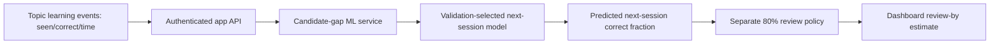

# Model architecture and prediction contracts

## Current deployed recall-score path

The current model predicts `next_session_correct / next_session_seen` conditional on a candidate gap of at most 30 days. The app's 80% crossing is a policy threshold applied to this score. The score is not a calibrated probability of long-term memory or a guaranteed date of forgetting.

## Existing candidate models

- Mean, linear regression and Random Forest baselines.
- HLR baseline: `H = exp(b0 + b1 * log(1 + cumulative_seen) + b2 * cumulative_accuracy)` and `p = 2 ** (-gap / H)`.
- GRU candidate: two-layer GRU over up to ten historical event feature rows, with a sigmoid output for next-session score.

Training features include cumulative exposure/accuracy, per-session exposure/accuracy and candidate gap. The report shows HLR chosen by validation MAE; GRU has lower ECE in the reported tests. Neither is validated against app-domain delayed recall.

## Knowledge tracing versus recall prediction

Knowledge tracing estimates the next response conditional on a sequence of previous learner-item interactions. Delayed retention estimates performance after a time gap and requires an appropriate delayed outcome. These are distinct targets. A KT model trained on the Duolingo trace must not be relabelled a course-topic forgetting model.

## RAG and state conditioning

The existing RAG path retrieves chunks using BM25 or BM25 + TF-IDF cosine similarity and RRF. Material quiz responses can produce repeated-error concept-gap scores. A deterministic gap-aware reranker is a transparent baseline; it is not a learned reranker or a deep-model mastery score. Source chunks and their material/chunk IDs remain the citation authority.

## Implemented sequence-model contract

`ml/src/knowledge_tracing.py` implements three PyTorch candidates: an order-agnostic MLP, a two-layer LSTM and a causal Transformer encoder. The MLP concatenates the current event embedding with a masked mean of event representations; it is a feedforward baseline, not a sequence-aware model. Each target token contains the known lexeme ID (or an explicit OOV index), pre-event history-seen/history-accuracy, elapsed days since the prior learner timestamp group, and the prior timestamp group's observed accuracy. A target's own correctness is only available to later timestamps, never its own input. Multiple rows at one learner timestamp are treated as a session group, so simultaneous peer answers are excluded from one another's history.

`ml/src/train_knowledge_tracer.py` trains each architecture, fits numeric scaling and item vocabulary from the training partition, uses early stopping on validation weighted binomial log loss, supports CPU/GPU, and writes a checkpoint with feature names, OOV/padding indices, scaler values, metadata and hash. It supports AdamW, Adam, RMSProp and SGD with momentum. `/predict/knowledge-tracing` serves a trained forward-time checkpoint. The API reports whether the requested item is OOV and labels the prediction experimental and uncalibrated.

This model predicts a next interaction's observed correct/seen fraction. It does not predict delayed recall. Duolingo lexeme IDs and the app's course-topic IDs are not aligned, so the KT API is not connected to the dashboard's per-topic review date. App-domain integration requires task-matched learner interaction data and evaluation.
